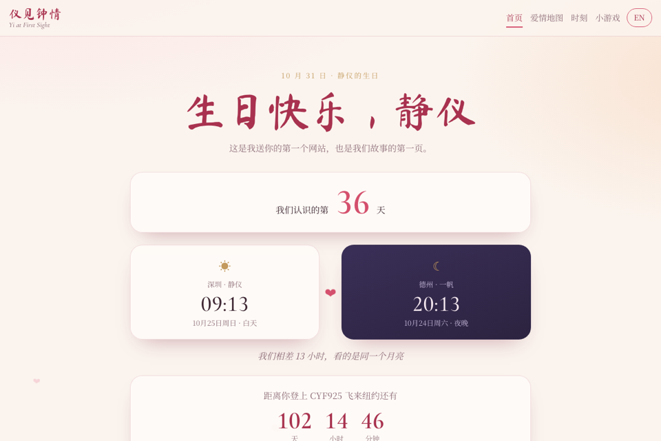
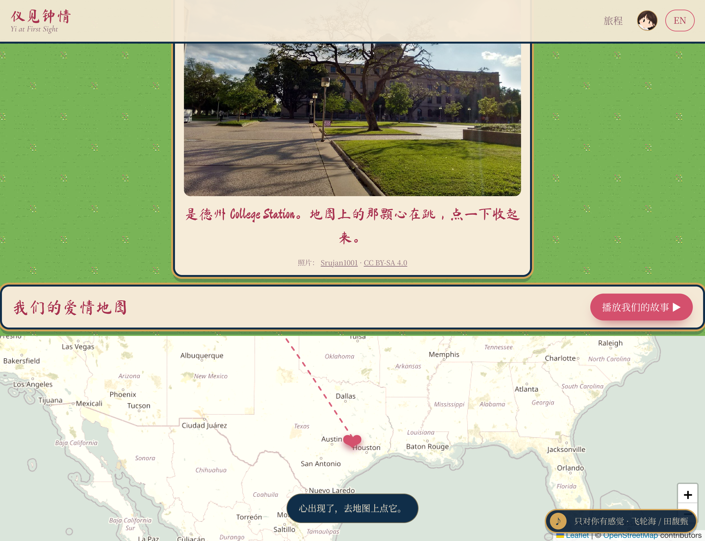
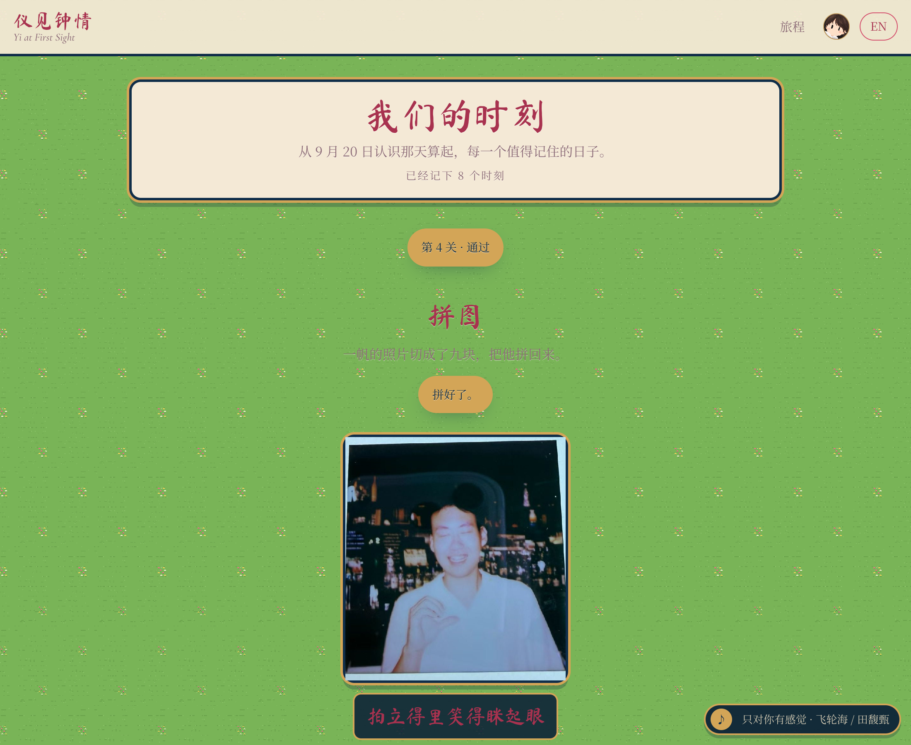
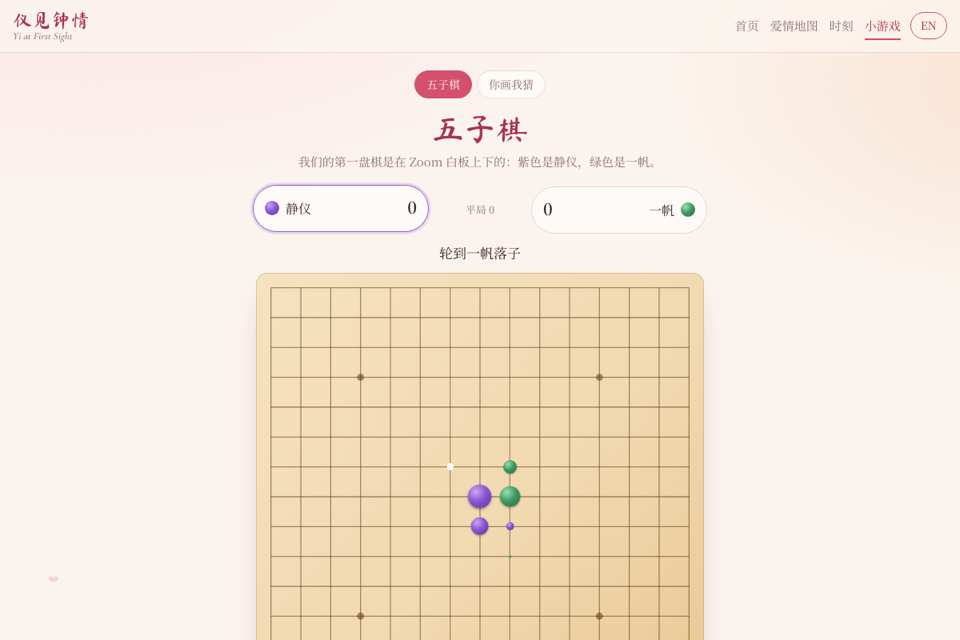

# Yi at First Sight · 仪见钟情

A private, bilingual (中文 / English) website for Yifan and Jingyi, a long-distance couple
between **Shenzhen, China** and **College Station, Texas**: thirteen hours and one Pacific
Ocean apart. Built as a birthday gift for **October 31, 2026**, and meant to grow with us.

The name puns on the Chinese idiom for "love at first sight" (一见钟情, *yi jian zhong qing*).
Both names contain the syllable *Yi*: Yi-fan and Jing-yi; the title swaps in the 仪 from Jingyi's name.

> Live at <https://rayford295.github.io/YI/> (not indexed by search engines). Personal photos and messages live here; do not redistribute.
> We plan to publish it once more features are in (see [docs/DEPLOY.md](docs/DEPLOY.md)).

<p align="center">
  
  
  
  
</p>

## Pages

| Route | Page | What it does |
|---|---|---|
| `#/start` | **Start** | Pick a player, Jingyi or Yifan; progress is per player, per device |
| `#/` | **Journey** | The level map: a gold meridian with six nodes; a locked level cannot be opened until the one before it is cleared |
| `#/met` | **The Day We Met** (level 1: answer one question from `src/core/quiz.ts`) | Birthday greeting, "day N since we met" (Shenzhen calendar), twin clocks that turn to night colours after 18:00, live hour difference, countdown to flight CYF925, the birthday letter |
| `#/map` | **Love Map** (level 2: find the three hidden hearts) | Pacific-centred map; one heart per place opens its memory cards; rose arc between our two cities with a heart flying along it; gold CYF925 route to New York; **Play our story** tours every memory and ends on the letter |
| `#/moments` | **Moments** (level 3: put five memories in order) | Timeline of every memory, each badged with its day number since we met |
| `#/gomoku` | **Gomoku** (level 4: fill the heart outline on the board) | Two players on one device, purple for Jingyi and green for Yifan; win tally, undo, saved game |
| `#/draw` | **Pictionary** (level 5: three correct guesses) | Draw on a canvas, hold to peek at the word, typed or spoken guesses, 90-second rounds, a shared "in sync" score |
| `#/ring` | **The Ring** (level 6, the reward) | Interactive 3D view of the pair of Meridian rings designed in `ring/` (hers with the stone, his a wide band), each engraved with the other’s name; **Try it on** puts the ring on your finger through the webcam (MediaPipe hand tracking, on-device), with a shutter for a captioned photo, and **Together, apart** joins one photo from each of us into a single card |

Every string exists in both languages. The toggle in the top bar switches the whole site
without a reload and remembers the choice. The games run entirely in the browser: no
backend, no accounts, nothing leaves the device.

## Status

- [x] Home, Love Map, Moments, Gomoku, Pictionary (v1, 2026-10-24)
- [x] 74 unit tests; the build type-checks with `strict` TypeScript
- [x] Checked in a real browser at desktop, 390 px and 320 px widths
- [ ] Yifan rewrites the birthday letter in his own words (`src/features/birthday-map/letter.ts`)
- [ ] Add inside-joke words to Pictionary (`src/features/pictionary/words.ts`)
- [x] Publishing rehearsed on GitHub Pages (2026-10-24), then taken offline again until more features land
- [ ] Later: gifts, daily notes, more games, an admin page for adding memories

## Repository Layout

```
YI/
├── index.html                  # page shell, fonts
├── public/media/<feature>/     # photos and videos, one folder per feature
├── src/
│   ├── main.ts                 # app shell, hash router, language toggle
│   ├── styles/base.css         # design tokens, top bar, cards, animations
│   ├── core/                   # shared by every feature
│   │   ├── i18n.ts             #   zh/en dictionary, t(), pick(), language state
│   │   ├── dates.ts            #   time-zone aware day counter, clocks, countdown
│   │   ├── geo.ts              #   great-circle arcs across the date line
│   │   ├── html.ts             #   attribute escaping, reduced-motion check
│   │   └── config.ts           #   names, time zones, key dates, next meeting
│   └── features/               # one folder per feature: code, styles, data, tests, README
│       ├── home/
│       ├── birthday-map/
│       ├── moments/
│       ├── games/              #   tabs shared by the game pages
│       ├── gomoku/
│       └── pictionary/
├── docs/
│   ├── DEPLOY.md               # how to publish (GitHub Pages) or host privately (Cloudflare)
│   ├── screenshots/
│   └── superpowers/            # design spec and implementation plans
└── .github/workflows/ci.yml    # tests + build on every push
```

Each feature folder has its own README explaining its files and rules.

## Everyday Edits

**Add a memory.** Drop the photo into `public/media/moments/` (JPEG, at most 1600 px on the
long side) and append an entry to `src/features/moments/memories.ts`. It appears on the map
and the timeline. The tests fail if the file is missing or either language is empty.

**Edit the letter.** Change the paragraphs in `src/features/birthday-map/letter.ts`, keeping
Chinese and English in step. `{h}` is replaced with the live hour difference.

**Add Pictionary words.** Append to `src/features/pictionary/words.ts`; `alt` lists other
answers that also count. A test fails if two words share an answer.

**Change a key date.** Everything is in `src/core/config.ts`.

**Add a feature.** Create `src/features/<name>/` with a README, a page module
(`renderX(root) => cleanup`), CSS and tests; put media in `public/media/<name>/`; register
the route in `src/main.ts` and the strings (both languages) in `src/core/i18n.ts`.

## Develop

```bash
npm install
npm run dev       # http://localhost:5173
npm test          # unit tests (Vitest)
npm run build     # type-check + production build into dist/
npm run preview   # serve dist/ locally
```

Stack: Vite, TypeScript (strict), Vitest, Leaflet with OpenStreetMap tiles. Node 22.
Every push runs the tests and the build.

## Key Dates

| Date | Moment |
|---|---|
| 2026-09-20 | We met (day 1) |
| 2026-09-25 | Yifan's birthday |
| 2026-10-31 | Jingyi's birthday, first release |
| 2027-02-05 | Flight CYF925, Shenzhen → New York (the ticket Yifan drew on our first Zoom) |
| 2027-02-08 to 02-12 | AAG Annual Meeting, New York |

## Docs

- Hosting: [`docs/DEPLOY.md`](docs/DEPLOY.md)
- Design spec: [`docs/superpowers/specs/2026-10-24-yi-at-first-sight-design.md`](docs/superpowers/specs/2026-10-24-yi-at-first-sight-design.md)
- Plan, part 1 (home + map): [`docs/superpowers/plans/2026-10-24-love-site-part1.md`](docs/superpowers/plans/2026-10-24-love-site-part1.md)
