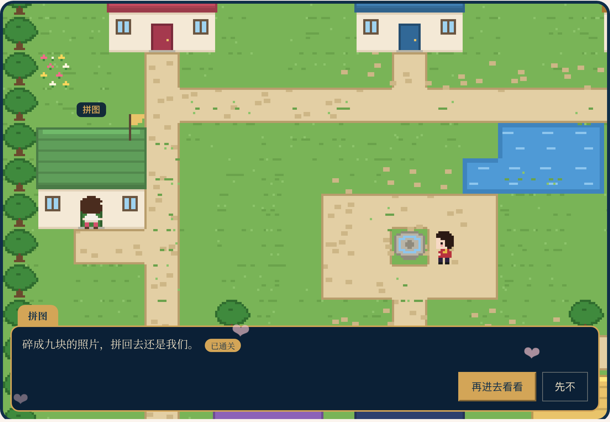
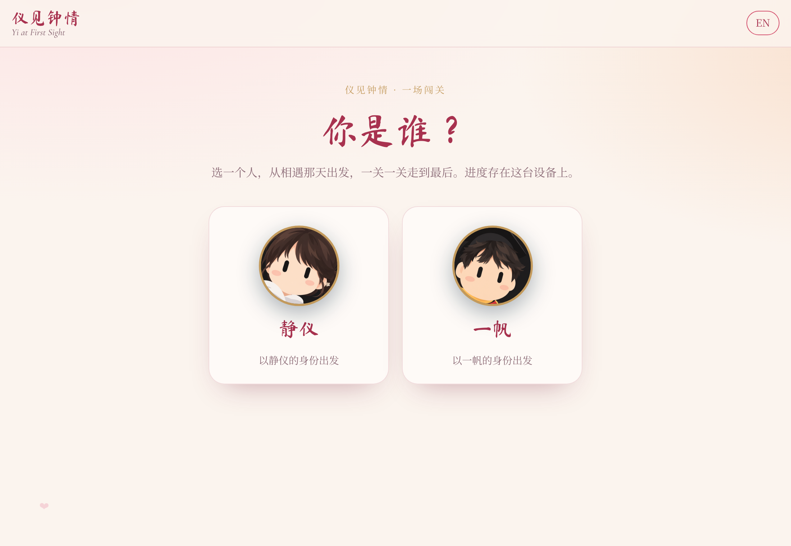

# Yi at First Sight · 仪见钟情

A private, bilingual (中文 / English) game for two: Yifan and Jingyi, a long-distance couple
between **Shenzhen, China** and **College Station, Texas**, thirteen hours and one Pacific Ocean
apart. You walk a small pixel version of yourself through a town, and every house is a level
made from something that happened to us. The last house holds a ring. Built as a birthday gift
for **October 31, 2026**, and meant to keep growing.

The name puns on the Chinese idiom for "love at first sight" (一见钟情, *yi jian zhong qing*).
Both names contain the syllable *Yi*: Yi-fan and Jing-yi; the title swaps in the 仪 from Jingyi's name.

> Live at <https://rayford295.github.io/YI/> (not indexed by search engines). Personal photos and
> messages live here; do not redistribute. Publishing is rehearsed and currently switched off
> while more features land (see [docs/DEPLOY.md](docs/DEPLOY.md)).

<p align="center">
  
  
  
  
</p>

## How It Plays

1. **The front door.** The site asks one question only the two of us can answer. The answer is
   kept as a hash and remembered on the device.
2. **Who are you?** Pick Jingyi or Yifan. Progress is per player, per device, so both of us can
   play on the same phone without stepping on each other.
3. **Yi Town.** You spawn by the fountain of a small town drawn entirely in code: grass, paths,
   a pond, trees, and eight houses with different roofs, one per level. Walk with the arrow keys
   or WASD, tap anywhere on the map to walk there, or use the on-screen d-pad on a phone. Your
   partner stands by the fountain and tells you how far they have got.
4. **Doors.** Step onto an open door and a talk box names the level and tells its one-line story.
   Go in, and the level opens. A house whose level is still locked has a cat sitting in front of
   the door who tells you which level to clear first. A cleared house flies a gold flag.
5. **Clearing a level** shows a card with confetti and a chime, and unlocks the next door. Coming
   back from a level puts you in front of that house.
6. **The ring** is the eighth house and the reward. Once both players have reached it on the
   same device, the partner by the fountain points to the epilogue: the last letter.

Every string exists in both languages; the toggle in the top bar switches the whole site without
a reload. Everything runs in the browser: no backend, no accounts, nothing leaves the device.
The site installs as an app (web manifest + service worker) and the shell works offline.

## The Levels

| # | Route | Level | What you do | What is inside |
|---|---|---|---|---|
| 1 | `#/met` | **The Day We Met** | Answer one question from `src/core/quiz.ts` | Birthday greeting, "day N since we met" on the Shenzhen calendar, twin clocks that turn to night colours after 18:00, the live hour difference, a countdown to flight CYF925 |
| 2 | `#/map` | **Love Map** | Find the three hidden hearts | Pacific-centred map; one heart per place opens its memory cards; a rose arc between our two cities with a heart flying along it; the gold CYF925 route to New York; **Play our story** tours every memory |
| 3 | `#/moments` | **Moments** | Put five memories in order | A timeline of every memory, each badged with its day number since we met |
| 4 | `#/puzzle` | **Puzzle** | Put the photo back together | A random photo from our moments cut into nine tiles; tap two to swap |
| 5 | `#/gomoku` | **Gomoku** | Fill the heart outline on the board | Two players on one device, purple for Jingyi and green for Yifan; win tally, undo, saved game |
| 6 | `#/draw` | **Pictionary** | Three correct guesses | Draw on a canvas, hold to peek at the word, typed or spoken guesses, 90-second rounds, a shared "in sync" score |
| 7 | `#/stars` | **That Night's Sky** | Find Vega and Altair | The sky over Shenzhen and over College Station at 21:00 on 2026-09-20, computed in the browser with astronomy-engine from a 130-star catalogue; Moon, planets, optional constellation lines |
| 8 | `#/ring` | **The Ring** | The reward | A reveal on first arrival (black, a rose drawing itself, the ring surfacing); an interactive 3D view of the pair of Meridian rings designed in `ring/`, each engraved with the other's name, with a design history of hers; **Try it on** puts the ring on your finger through the webcam (MediaPipe hand tracking, on-device); **Together, apart** joins one photo from each of us into a single card |
| · | `#/letter` | **The Last Letter** | The epilogue | Opens only when both players have cleared the ring on this device |

<p align="center">
  
  
  
  
  
  
  
  
</p>

Other routes: `#/start` picks the player, `#/journey` is the list view of the same levels (a gold
meridian with one node per level), kept for small screens and reduced motion.

If a voice line exists at `public/media/voice/<level>.m4a`, the cleared card gets a **Listen** button.

## The Town

Everything in `src/features/world/` is drawn with the canvas API at load time: there are no image
files and no game engine. The map is a 24×20 character grid (`town.ts`), the ground tiles and
houses are painted once onto an offscreen canvas (`tiles.ts`), and the two of us plus the cat are
12×16 pixel sprites written as strings, four facings and two walk frames each (`sprites.ts`),
drawn after our avatars. The engine (`engine.ts`) moves one tile per step with easing, follows
with a clamped camera, finds the shortest path for taps, and renders at an integer pixel scale so
nothing blurs.

| Control | Desktop | Phone |
|---|---|---|
| Walk | Arrows or WASD (tap for one tile, hold to keep going); click a tile to walk there | Tap a tile, or hold the d-pad |
| Go in / talk | Enter, Space or Z | A button |
| Close the talk box | Escape | Not now |

Where you stood is remembered per player; **Start over** in the footer clears it with the progress.
Tests guarantee the map is a rectangle, every level has exactly one house, every door is reachable
from the spawn, and locked doors stay shut. Design notes:
[docs/superpowers/specs/2026-10-26-town-design.md](docs/superpowers/specs/2026-10-26-town-design.md).

## Status

- [x] Home, Love Map, Moments, Gomoku, Pictionary (v1, 2026-10-24)
- [x] Game of levels with real locks, Puzzle, That Night's Sky, the ring, the epilogue letter, the entry gate, PWA (2026-10-25 and 10-26)
- [x] The town as the home page, with tap-to-walk and house name plates (2026-10-26)
- [x] 96 unit tests; the build type-checks with `strict` TypeScript; CI runs both on every push
- [x] Checked in a real browser at desktop, 390 px and 320 px widths
- [ ] Yifan rewrites the last letter in his own words (`src/features/birthday-map/letter.ts`)
- [ ] Record voice lines for the cleared cards (`public/media/voice/README.md`)
- [ ] Add inside-joke words to Pictionary (`src/features/pictionary/words.ts`)
- [ ] Town: footsteps and door sounds, animated water, a cat that moves with the story
- [ ] Later: a long road from Shenzhen to College Station as a second map, gifts, daily notes, two players online at once

## Repository Layout

```
YI/
├── index.html                  # page shell, fonts
├── public/media/<feature>/     # photos, videos, models, avatars; one folder per feature
├── src/
│   ├── main.ts                 # app shell, gate, hash router, lazy routes, language toggle
│   ├── styles/base.css         # design tokens, top bar, cards, animations
│   ├── core/                   # shared by every feature
│   │   ├── i18n.ts             #   zh/en dictionary, t(), pick(), language state
│   │   ├── quest.ts            #   level registry, per-player progress, locks
│   │   ├── quest-ui.ts         #   avatars, cleared card, toast
│   │   ├── gate.ts             #   entry question (SHA-256 of accepted answers)
│   │   ├── celebrate.ts        #   confetti, chime, voice-line URL
│   │   ├── dates.ts geo.ts     #   time-zone aware day counter and clocks; great-circle arcs
│   │   └── config.ts           #   names, time zones, key dates, next meeting
│   └── features/               # one folder per feature: code, styles, data, tests, README
│       ├── gate/ start/        #   the front door, the player picker
│       ├── world/              #   the town: town.ts (map), tiles.ts, sprites.ts, engine.ts, world.ts
│       ├── journey/            #   the list view
│       ├── home/ birthday-map/ moments/ puzzle/ gomoku/ pictionary/ games/
│       ├── stars/              #   catalog.ts (stars), sky.ts (projection), stars.ts (page)
│       ├── ring/               #   3D viewer, webcam try-on, photo card
│       └── letter/             #   the epilogue
├── ring/                       # the ring's Blender script and renders
├── docs/
│   ├── DEPLOY.md               # how to publish (GitHub Pages) or host privately (Cloudflare)
│   ├── screenshots/
│   └── superpowers/            # design specs and implementation plans
└── .github/workflows/ci.yml    # tests + build on every push
```

Each feature folder has its own README explaining its files and rules.

## Everyday Edits

**Add a memory.** Drop the photo into `public/media/moments/` (JPEG, at most 1600 px on the
long side) and append an entry to `src/features/moments/memories.ts`. It appears on the map,
the timeline and the puzzle. The tests fail if the file is missing or either language is empty.

**Edit the letter.** Change the paragraphs in `src/features/birthday-map/letter.ts`, keeping
Chinese and English in step. `{h}` is replaced with the live hour difference.

**Add Pictionary words.** Append to `src/features/pictionary/words.ts`; `alt` lists other
answers that also count. A test fails if two words share an answer.

**Change a key date.** Everything is in `src/core/config.ts`.

**Change the entry question.** Edit `gate.question` and `gate.placeholder` in
`src/core/i18n.ts`, then run `npm run gate -- "answer" "another spelling"` and paste the hashes
into `ANSWERS` in `src/core/gate.ts`. Answers are compared digits-only.

**Add a level.** Append it to `LEVELS` in `src/core/quest.ts`, add its title/story/task strings,
register the route in `src/main.ts`, call `levelCleared('<id>')` when the task is done, and give
it a house in `BUILDINGS` (`src/features/world/town.ts`) with a door tile on the grid. Level
numbers are derived from the registry; a test fails until the new door is reachable.

**Add a feature.** Create `src/features/<name>/` with a README, a page module
(`renderX(root) => cleanup`), CSS and tests; put media in `public/media/<name>/`; register
the route in `src/main.ts` and the strings (both languages) in `src/core/i18n.ts`.

## Develop

```bash
npm install
npm run dev       # http://localhost:5173
npm test          # unit tests (Vitest)
npm run build     # type-check + production build into dist/
npm run preview   # serve dist/ locally
```

Stack: Vite, TypeScript (strict), Vitest, canvas 2D for the town, Leaflet with OpenStreetMap
tiles, three.js, MediaPipe Tasks Vision, astronomy-engine, vite-plugin-pwa. Node 22.

## Key Dates

| Date | Moment |
|---|---|
| 2026-09-20 | We met (day 1) |
| 2026-09-25 | Yifan's birthday |
| 2026-10-31 | Jingyi's birthday, first release |
| 2027-02-05 | Flight CYF925, Shenzhen → New York (the ticket Yifan drew on our first Zoom) |
| 2027-02-08 to 02-12 | AAG Annual Meeting, New York |

## Docs

- Hosting: [`docs/DEPLOY.md`](docs/DEPLOY.md)
- Site design: [`docs/superpowers/specs/2026-10-24-yi-at-first-sight-design.md`](docs/superpowers/specs/2026-10-24-yi-at-first-sight-design.md)
- The game of levels: [`docs/superpowers/specs/2026-10-25-quest-design.md`](docs/superpowers/specs/2026-10-25-quest-design.md)
- The town: [`docs/superpowers/specs/2026-10-26-town-design.md`](docs/superpowers/specs/2026-10-26-town-design.md)
- Plan, part 1 (home + map): [`docs/superpowers/plans/2026-10-24-love-site-part1.md`](docs/superpowers/plans/2026-10-24-love-site-part1.md)
