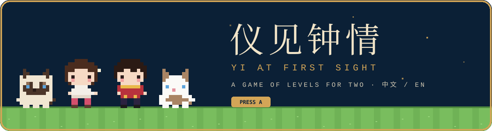
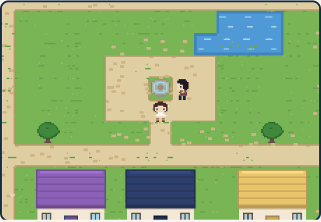

<p align="center">
  
</p>

<p align="center">
  
  
  
  
  
  
</p>

<p align="center">
  <b>A private, bilingual game for two.</b><br/>
  Walk a small pixel version of yourself through a town.<br/>
  Every house is a level made from something that happened to us.<br/>
  The last house holds a ring.
</p>

<p align="center">
  
</p>

<p align="center">
  <sub>Yifan and Jingyi live thirteen hours and one Pacific Ocean apart, in College Station, Texas and Shenzhen, China.<br/>
  Built as a birthday gift for October 31, 2026, and meant to keep growing. The name puns on 一见钟情, <i>love at first sight</i>: both names carry the syllable <i>Yi</i>, and the title borrows the 仪 from Jingyi's.</sub>
</p>

<br/>

## ▶ How It Plays

```
  ┌──────────────────────────────────────────────────────────────┐
  │  ONE QUESTION  →  WHO ARE YOU?  →  THE TOWN  →  EIGHT DOORS   │
  └──────────────────────────────────────────────────────────────┘
```

- **One question** only the two of us can answer opens the door. The answer is stored as a hash.
- **Pick who you are.** Progress is kept per player, per device, so both of us can play on one phone.
- **Walk the town** with the arrow keys or WASD, a tap on any tile, or the d-pad on a phone. Your
  partner waits by the fountain and tells you how far they have got. The sky follows the clock
  in your own city, so one of us walks it by day and the other by lamplight.
- **Step onto a door** and a talk box tells that level's story. Go in and play it. A cleared house
  flies a gold flag.
- **Our cats keep the locks.** Coffee sits at the next locked door and Duoduo at the one after, and
  each tells you, in its own way, which level to clear first. When a door opens they get up and
  walk to the next one, and with nothing left to guard they go and sunbathe by the pond or sit in
  the middle of the square.
- **Two signposts** lead out of the square: east to a day of Yifan's in College Station, west to a
  day of Jingyi's in Shenzhen. Each is a map of that person's stops with their hours, and their
  sprite stands wherever the clock in that city puts them. A red mailbox by the fountain holds
  the voice notes the other one left; a jukebox in the corner plays our songs.
- **The ring** is the eighth house. When both of us have reached it, the partner points to the
  last letter. Progress lives on each phone, so a short code (or a link) carries it across.

The whole site stands on the town's meadow, and every heading is a sign in the same cream and navy.
Everything runs in the browser and nothing leaves the device. The whole site exists in both
languages, and it installs as an app that works offline.

## ⌂ The Houses

Each roof in the town has its own colour and carries its number. Walk into the door to play the level.

| Roof | # | Level | The task | Behind the door |
|:---:|:---:|---|---|---|
| 🟥 | 1 | The Day We Met | Answer one question | Day counter since we met, twin clocks, countdown to the next flight |
| 🟦 | 2 | Love Map | Find three hidden hearts | A Pacific-centred map of every place that matters, with our story as a tour |
| 🟧 | 3 | Moments | Put five memories in order | The timeline, each memory badged with its day number |
| 🟩 | 4 | Puzzle | Put the photo back together | The other one's face in nine tiles |
| 🟫 | 5 | Gomoku | Fill the heart outline | Two players on one device, with a saved game |
| 🟪 | 6 | Pictionary | Three correct guesses | Draw, guess by typing or speaking, 90-second rounds |
| ⬛ | 7 | That Night's Sky | Find Vega and Altair | The sky over both cities at 21:00 on 2026-09-20, computed in the browser |
| 🟨 | 8 | The Ring | The reward | What is inside is not written down here |
| ✉️ | · | The Last Letter | The epilogue | Opens once both players have reached the ring |

## ⌨ Develop

```bash
npm install
npm run dev       # http://localhost:5173
npm test          # 128 unit tests (Vitest)
npm run build     # strict type-check + production build
npm run banner    # redraw docs/banner.svg from the sprite data
npm run icon      # redraw favicon.svg and the PNG icons from the sprites
```

Vite · TypeScript · canvas 2D for the town (every tile and sprite is a string in `sprites.ts`
and `tiles.ts`; there are no image files for the game) · Leaflet · three.js · MediaPipe ·
astronomy-engine · Node 22. CI runs the tests and the build on every push.

## ⚑ More

- [docs/CHANGELOG.md](docs/CHANGELOG.md): what changed, by version
- [docs/GUIDE.md](docs/GUIDE.md): repository layout, everyday edits (add a memory, a word, a level), status, key dates, screenshots of every level
- [docs/DEPLOY.md](docs/DEPLOY.md): publishing and private hosting
- Design notes: [the site](docs/superpowers/specs/2026-10-24-yi-at-first-sight-design.md) · [the game of levels](docs/superpowers/specs/2026-10-25-quest-design.md) · [the town](docs/superpowers/specs/2026-10-26-town-design.md)
- Each folder under `src/features/` has its own README.

<p align="center">
  <sub>Live at <a href="https://jingyifan.love/">jingyifan.love</a>, unlisted. Personal photos and messages live here; please do not redistribute.</sub>
</p>

<p align="center">
  <sub>🐾 <b>Coffee</b>: ...Meow. This door is locked. Clear the one before it first.</sub>
</p>
