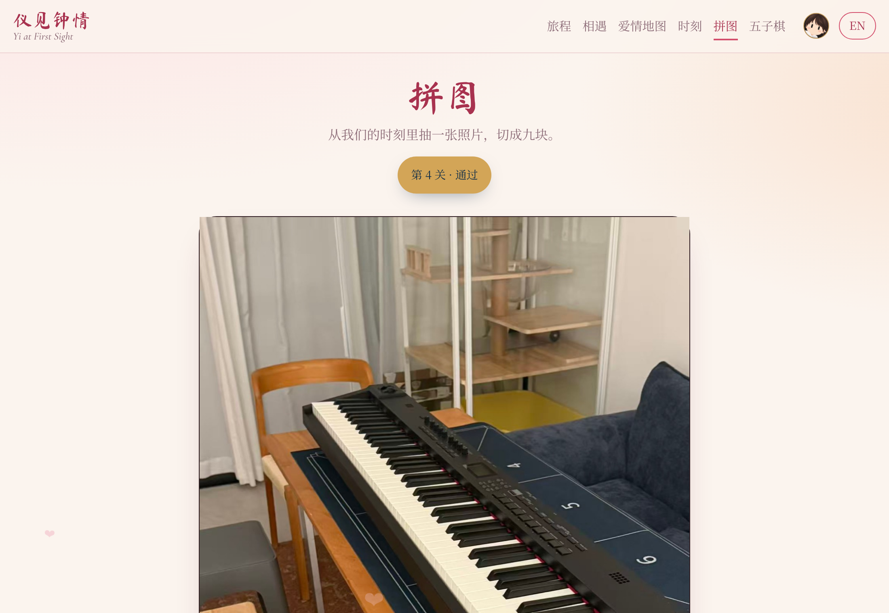
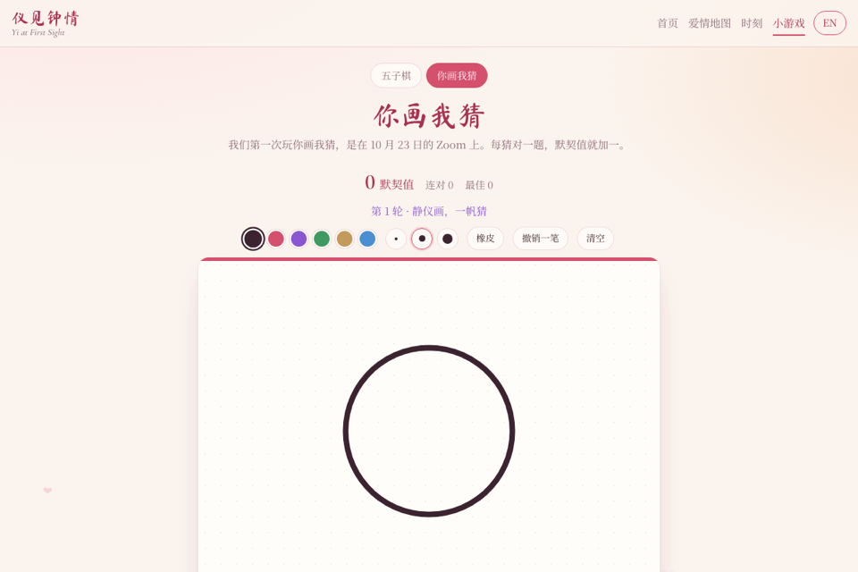

# Guide: Layout, Everyday Edits, Status

The README is the short tour. This file holds the working detail: where things live, how to make
the usual edits, what is done and what is still owed.

## Repository Layout

```
YI/
├── index.html                  # page shell, fonts
├── public/media/<feature>/     # photos, videos, models, avatars; one folder per feature
├── src/
│   ├── main.ts                 # app shell, gate, hash router, lazy routes, language toggle
│   ├── styles/base.css         # design tokens, top bar, cards, animations
│   ├── core/                   # shared by every feature
│   │   ├── i18n.ts             #   zh/en dictionary, t(), pick(), language state
│   │   ├── quest.ts            #   level registry, per-player progress, locks
│   │   ├── sync.ts             #   progress codes (encode, decode, merge)
│   │   ├── quest-ui.ts         #   avatars, cleared card, toast
│   │   ├── gate.ts             #   entry question (SHA-256 of accepted answers)
│   │   ├── celebrate.ts        #   confetti, chime, voice-line URL
│   │   ├── dates.ts geo.ts     #   time-zone aware day counter and clocks; great-circle arcs
│   │   └── config.ts           #   names, time zones, key dates, next meeting
│   └── features/               # one folder per feature: code, styles, data, tests, README
│       ├── gate/ start/ sync/  #   the front door, the player picker, progress codes
│       ├── world/              #   the town: town.ts (map), tiles.ts, sprites.ts, engine.ts, world.ts
│       ├── journey/            #   the list view
│       ├── home/ birthday-map/ moments/ puzzle/ gomoku/ pictionary/ games/
│       ├── stars/              #   catalog.ts (stars), sky.ts (projection), stars.ts (page)
│       ├── ring/               #   3D viewer, webcam try-on, photo card
│       └── letter/             #   the epilogue
├── ring/                       # the ring's Blender script and renders
├── docs/
│   ├── DEPLOY.md               # how to publish (GitHub Pages) or host privately (Cloudflare)
│   ├── screenshots/
│   └── superpowers/            # design specs and implementation plans
└── .github/workflows/ci.yml    # tests + build on every push
```

Each feature folder has its own README explaining its files and rules.
## Everyday Edits

**Add a memory.** Drop the photo into `public/media/moments/` (JPEG, at most 1600 px on the
long side) and append an entry to `src/features/moments/memories.ts`. It appears on the map,
the timeline and the puzzle. The tests fail if the file is missing or either language is empty.

**Edit the letter.** Change the paragraphs in `src/features/birthday-map/letter.ts`, keeping
Chinese and English in step. `{h}` is replaced with the live hour difference.

**Add Pictionary words.** Append to `src/features/pictionary/words.ts`; `alt` lists other
answers that also count. A test fails if two words share an answer.

**Change a key date.** Everything is in `src/core/config.ts`.

**Redraw the README banner.** `npm run banner` regenerates `docs/banner.svg` from the sprite strings in
`src/features/world/sprites.ts`, so a new outfit or a new cat shows up there too.

**Change the entry question.** Edit `gate.question` and `gate.placeholder` in
`src/core/i18n.ts`, then run `npm run gate -- "answer" "another spelling"` and paste the hashes
into `ANSWERS` in `src/core/gate.ts`. Answers are compared digits-only.

**Add a level.** Append it to `LEVELS` in `src/core/quest.ts`, add its title/story/task strings,
register the route in `src/main.ts`, call `levelCleared('<id>')` when the task is done, and give
it a house in `BUILDINGS` (`src/features/world/town.ts`) with a door tile on the grid. Level
numbers are derived from the registry; a test fails until the new door is reachable.

**Add a feature.** Create `src/features/<name>/` with a README, a page module
(`renderX(root) => cleanup`), CSS and tests; put media in `public/media/<name>/`; register
the route in `src/main.ts` and the strings (both languages) in `src/core/i18n.ts`.
## Status

- [x] Home, Love Map, Moments, Gomoku, Pictionary (v1, 2026-10-24)
- [x] Game of levels with real locks, Puzzle, That Night's Sky, the ring, the epilogue letter, the entry gate, PWA (2026-10-25 and 10-26)
- [x] The town as the home page, with tap-to-walk and house name plates (2026-10-26)
- [x] 106 unit tests; the build type-checks with `strict` TypeScript; CI runs both on every push
- [x] Checked in a real browser at desktop, 390 px and 320 px widths
- [ ] Yifan rewrites the last letter in his own words (`src/features/birthday-map/letter.ts`)
- [ ] Record voice lines for the cleared cards (`public/media/voice/README.md`)
- [ ] Add inside-joke words to Pictionary (`src/features/pictionary/words.ts`)
- [x] Coffee and Duoduo, the two cats, as pixel sprites with their own lines and photos (2026-10-26)
- [x] Progress codes: `#/sync` carries progress between phones as a code or link (v1.1.0, 2026-10-26)
- [x] The whole site stands on the town's pixel meadow with the time-of-day wash; headings on signs, panels in cream and navy (2026-10-26)
- [x] Town: a one-time welcome line with the controls; phone checklist in DEPLOY.md (2026-10-26)
- [x] Town: day and night follow the player's own city, with lit windows; resting cats fidget (2026-10-26)
- [x] Town: cats walk to their new posts when a door opens; iris transition in and out of houses (2026-10-26)
- [x] Town: footsteps, thud, talk-box and door sounds (synthesised, with a switch), drifting pond and fountain glint (2026-10-26)
- [x] Domain chosen: jingyifan.love (2026-10-26); live at https://jingyifan.love/ with HTTPS since 2026-10-26 (deploy on every push while `PUBLISH` is true)
- [ ] Later: a long road from Shenzhen to College Station as a second map, gifts, daily notes, two players online at once
## Key Dates

| Date | Moment |
|---|---|
| 2026-09-20 | We met (day 1) |
| 2026-09-25 | Yifan's birthday |
| 2026-10-31 | Jingyi's birthday, first release |
| 2027-02-05 | Flight CYF925, Shenzhen → New York (the ticket Yifan drew on our first Zoom) |
| 2027-02-08 to 02-12 | AAG Annual Meeting, New York |

## The Levels in Pictures

<p align="center">
  
  
  
  
  
  
  
  
  
</p>
